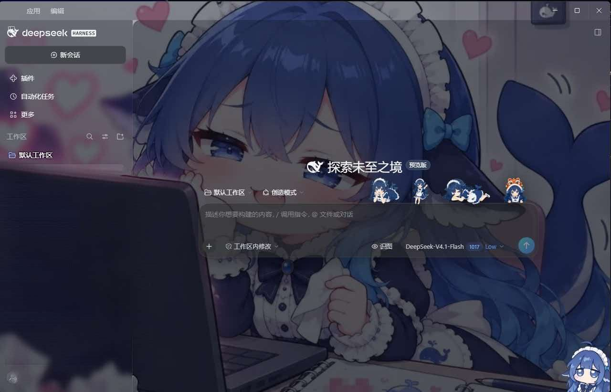

# dsh-chat-backdrop

> 给 DSH 的聊天界面换一张脸：一张壁纸铺在对话区背后，周边面板变成半透明玻璃，输入框上沿站着四只鲸鱼娘。



<sub>默认工作区：壁纸铺底、侧栏与输入框半透明、输入框上沿站着四只鲸鱼娘</sub>

一个纯客户端的 [DSH](https://github.com/deepseek-ai/deepseek-harness) 插件：不联网、不读本地文件、不加任何命令或工具，只做视觉。

## 它做了什么

| | |
|---|---|
| **壁纸** | 用 `body::before` 铺满视口，46 秒一轮缓慢推拉 + 不超过 14px 的指针视差；叠一层噪点、顶部高光和暗角，避免照片直接平铺的廉价感 |
| **玻璃面板** | 侧栏、设置页与弹窗改成半透明 + `backdrop-filter` 模糊；**输入框卡片故意不加模糊**，原因见下面的「已知问题」 |
| **鲸鱼娘** | 四张透明姿势图固定在输入框上沿，从卡片中线铺到右侧，随输入框尺寸变化重新定位；用 `MutationObserver` 跟随 composer 挂载，不会被 React 重渲染吃掉。打开设置页或任何对话框时自动隐藏，不挡内容 |
| **明暗双主题** | token 同时提供 light / dark 两套取值，跟随 DSH 外观设置切换 |
| **入场动画** | 首次加载与切换会话时有一次约 1.4 秒的渐入；检测到 `prefers-reduced-motion` 时自动跳过 |
| **零请求** | 图片全部 base64 内联进 `client.js`，运行时没有任何网络请求 |

## 安装

**推荐**：在 DSH 里用插件管理器安装，目标填 npm 规格 `github:karlalt9/dsh-chat-backdrop`。

装完确认 profile 的 `package.json` 里 `dsh.profile.bundles` 包含 `dsh-chat-backdrop`（没自动加就手动补一行），然后**完全退出 DSH 再打开**——bundle 清单只在启动时读一次，`Ctrl+R` 刷新页面不够。

命令行也可以，但它只把包装进 node_modules，**不会写 `dsh.profile.bundles`**：

```sh
dsh plugin --profile desktop add github:karlalt9/dsh-chat-backdrop
```

## 自己换图

```sh
# 1. 换壁纸：直接覆盖 backdrop.jpg（建议 16:9，300KB 以内）
# 2. 换角色姿势：覆盖 assets/pose-1.png ~ pose-4.png（透明背景 PNG，高度 150px 左右最协调）
# 3. 重新内联生成 client.js
node gen-client.mjs
```

配色不在这两处，而在 `client.template.js` 的 `TOKENS` 表里——每个 token 都是 `{ light, dark }` 两个值。

> `--dsw-specific-sidebar-fill` 同时被窗口框架和标题栏拖拽条使用，所以改它会连带改变标题栏亮度；`client.template.js` 里为此有一条配套的 `[data-windows-titlebar]` 规则，两个要一起改。

## 已知问题

**输入框没有 `backdrop-filter`。** 之前给 composer 卡片加过模糊，结果是鼠标移到发送键上时整个输入框区域持续闪烁。逐步排查删掉了按钮的 `filter`、阴影过渡、悬停样式、卡内全部 `transition`，仍然闪；去掉该卡片的 `backdrop-filter` 后消失。判断是 Chromium 在带背景模糊的元素内部发生重绘时反复重采样背景所致。因此输入框改用不透明度（58%，聚焦 68%）保证可读性。侧栏、对话框、菜单的模糊不受影响。

如果在你机器上鼠标划过**侧栏会话列表**也出现类似闪动，把 `client.template.js` 中 `[class*="_sidebarCol"]` 的 `backdrop-filter` 换成更高的底色即可，思路相同。

## 兼容性

- 在 DSH 0.2.x（desktop profile）上验证过，`engines.dsh` 限定 `>=0.2.0-0 <0.3.0`。
- 只依赖 `@deepseek-ai/dsh-client-ui-theme` 暴露的 token，不硬编码组件类名；composer 卡片是按「圆角 + 有背景色 + 内部有按钮」的形状识别出来的，所以 DSH 换肤后一般还能定位到。
- 少数选择器依赖类名后缀（`_sidebarCol` / `_bubble` / `_frame`），用的是子串匹配，构建哈希变化不影响。
- 如果某次 DSH 大改 composer 结构导致小人位置飘了，`client.template.js` 里的 `findComposerCard()` 是唯一需要调的地方。

## 目录结构

```
index.js              host 侧空实现（纯客户端插件）
client.js             构建产物：CSS + token + 内联图片，DSH 直接加载这个
screenshot.jpg        README 用的实机截图
client.template.js    源码（带占位符），改这个然后重新生成
gen-client.mjs        把 backdrop.jpg 与 assets/pose-*.png 内联进 client.js
cordis.patch.yml      bundle 声明
.gitattributes        client.js 标记为生成文件，不参与 diff
assets/               四张姿势图
locale/               中英文名称与描述
```

## 卸载

把 `dsh-chat-backdrop` 从 `dsh.profile.bundles` 里删掉并重启。样式节点和 token 覆盖都注册在 `ctx.effect` 的清理函数里，卸载即还原，不留残留。

## License

MIT，见 [LICENSE](LICENSE)。仓库内的图片素材（`backdrop.jpg`、`assets/*.png`）随代码以同一许可提供。

> 这是非官方个人作品，与 DeepSeek 官方无关。鲸鱼形象源自 DeepSeek 的吉祥物，这里只是二次创作；壁纸为作者个人照片，随 MIT 一并授权再分发。
